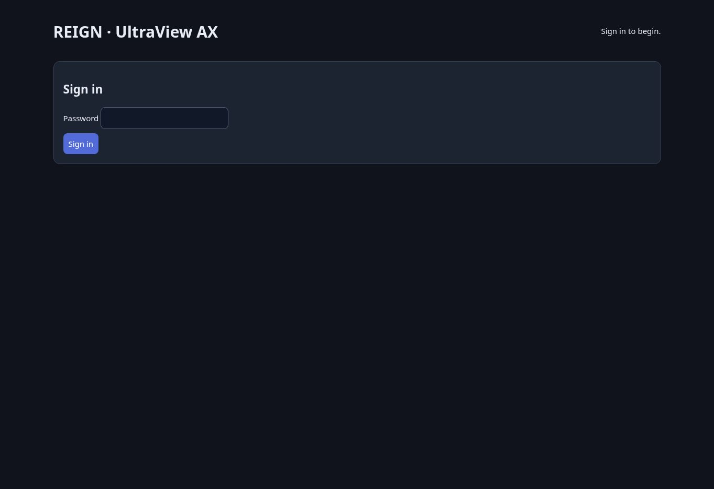

# REIGN live deployment receipt

Verified 2026-11-08, 23:11 UTC. **All four Render deployments are live at the
reviewed immutable image digests.** This establishes service deployment and
public console checks, not authenticated end-to-end or human acceptance.

Console: https://reign-ax-pilot-d934.onrender.com/
Blueprint: https://dashboard.render.com/blueprint/exs-dbofqkm417fc7384kou0
Applied sync: https://dashboard.render.com/blueprint/exs-dbofqkm417fc7384kou0/sync/exe-dbog24s9v7es73f5olv0

## Ownership and approved scope

- Jim's workspace `tea-dbdccfpsrm7s73b8rugg`, Oregon.
- James approved Blueprint ownership, the four-service base budget of about
  $64.25/month, and initial launch without REIGN database persistence.
- Blueprint branch main, path `deploy/render-pilot.proposed.yaml`, auto-sync off.
- Applied revision `0d86c58ca1bb3bfba06d22ef93785b30163d26ae` (PR #5 startup fix).
- Core/AX: 0.5 CPU / 512 MB each. Computer/Temporal: 1 CPU / 2 GB each.
  Temporal has a 1 GB disk at `/data`. The estimate excludes usage/tax/extras.
- Only AX is public. The other three services use the workspace private network.
- Existing Workmates, Git High, Moby Alpha and shared database were not changed.
- Runtime credentials were generated by Render; no secret values were read,
  copied into this receipt, committed or printed.
- The old OpenTofu workflow is disabled. Its `provision:false` manifest is
  historical release metadata, not the state of these live Blueprint services.

## Service receipt

| Component | Service ID | Verified live deploy | Status |
|---|---|---|---|
| Temporal | `srv-dbofv3rrjlhs73basukg` | `dep-dbofv43rjlhs73basvk0` | Live |
| Computer | `srv-dbofvbrrjlhs73bathc0` | `dep-dbog273rjlhs73bb4sug` | Live |
| Core | `srv-dbog273rjlhs73bb4t90` | `dep-dbog27jrjlhs73bb4uag` | Live |
| Ax | `srv-dbog2f3rjlhs73bb5f0g` | `dep-dbog2ffig07c73a6pp90` | Live |

Complete digests and timestamps: [`deploy/live-receipt.json`](../deploy/live-receipt.json).
Image source: `bd01832f2b29c5587e763adbc6f17481fba74f64`.
Temporal logs confirm it listens on port 7233 and persists at `/data/temporal.db`.
Do not infer its port from the generic private-service URL field in the API.

## Verification actually performed

- All four latest deployment records report `live`; each digest matches the
  tested release manifest exactly. Actual Render registry pulls succeeded.
- Public `GET /healthz`: HTTP 200, `{"status":"ok"}`.
- Public `GET /`: HTTP 200 with the AX login form and `Cache-Control: no-store`.
- Anonymous `GET /api/readyz`: HTTP 401.
- Anonymous `POST /api/sessions`: HTTP 401, no session created.
- Cloud browser rendered the real public AX sign-in screen over HTTPS.
- Render error-level log query across all four services from 23:10:20 to 23:11:18
  returned no entries. This short startup window is not a soak test.
- Initial idle memory samples near 23:11:20: Temporal 69.6 MiB, Computer 56.7 MiB,
  Core 52.3 MiB, latest AX instance 37.4 MiB. No browser workload was running;
  these samples do not justify downsizing or establish capacity.

## Startup failure and recovery

The first approved sync started Temporal, but Computer exited 127: Render treated
an outer-quoted shell program as a command name. PR #5 clears the unnecessary
Computer/Core overrides, using their tested image CMD and existing host-variable
fallbacks. AX uses the documented `/bin/sh -c PROGRAM` format without outer quotes.
No image digest, compute size, disk, scope or secret-reference changes were needed.
The same Blueprint was replanned and applied; no duplicate resources were created.

## CI evidence

- [Original image CI](https://github.com/Alambdasystem/Reign-iac/actions/runs/42527808432)
  and [tested image release](https://github.com/Alambdasystem/Reign-iac/actions/runs/42527962724): passed.
- [Blueprint ownership PR CI](https://github.com/Alambdasystem/Reign-iac/actions/runs/42532723693): passed.
- [Startup fix PR CI](https://github.com/Alambdasystem/Reign-iac/actions/runs/42533490046): passed all four required jobs.
- [Post-fix main CI](https://github.com/Alambdasystem/Reign-iac/actions/runs/42533696997): passed.

Required jobs cover infrastructure validation/mock tests, 45 Python tests, six
PostgreSQL integration tests and four Docker builds with actual browser acceptance
inside CI. Local startup-fix checks also passed the official Blueprint schema,
private-host fallback checks and shell syntax/AX endpoint expansion.

## Remaining acceptance and access

Authenticated dependency readiness, actual Render browser open/live frames,
takeover/handback, stale-input rejection, cleanup and restart recovery have **not
been run**. James's human acceptance has **not been run**. Do not mark them passed
from deployment status, public health checks, or CI results.

The Render connector can manage deployments and inspect logs but does not expose
remote shell execution. The separate dashboard browser was not signed in, and its
secure sign-in flow was not completed. This is an access dependency for private
runtime tests, not missing deployment approval. Never request credentials in chat
or weaken authentication to finish testing.

For the next authenticated check, use the authorized AX service shell and its
existing runtime environment to call the public `/api/readyz` with `CORE_TOKEN`
without printing the token. Then run live browser acceptance and record workflow
IDs/frame evidence, followed by James's actual takeover and handback. Obtain the
human AX password from the owner's Render Environment settings through secure
sign-in handling; never copy it into this public repository.

The shared DB remains unchanged and REIGN database persistence disabled. Prepare
and verify a restricted REIGN schema/role over the existing private network before
connecting Core. External computer/full-desktop adapters and Create/Connect UI
remain unfinished; the live worker is the managed Chromium pilot only.
